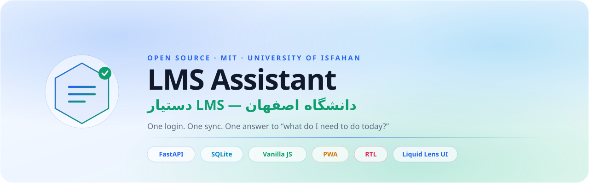
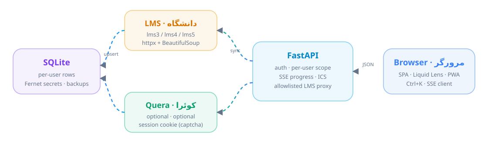

<p align="center">
  <picture>
    <source media="(prefers-color-scheme: dark)" srcset="assets/banner-dark.svg">
    <source media="(prefers-color-scheme: light)" srcset="assets/banner-light.svg">
    
  </picture>
</p>

<p align="center">
  <a href="#-فارسی"><b>فارسی</b></a> ·
  <a href="#-english"><b>English</b></a> ·
  <a href="docs/RESTORE.md">Backup restore</a> ·
  <a href="https://github.com/Asadix85/lms-assistant/issues">Issues</a>
</p>

<p align="center">
  
  
  
  
  
  
  <a href="https://github.com/Asadix85/lms-assistant/actions/workflows/ci.yml"></a>
</p>

---

<div dir="rtl">

## 🇮🇷 فارسی

> سامانهٔ LMS برای **بایگانی** ساخته شده، نه برای **امروز**.
> این دستیار همان داده را می‌گیرد و به یک سؤال جواب می‌دهد: **«الان چه چیزی از من می‌خواهند؟»**

هر ترم همان داستان تکرار می‌شود: برای دیدن یک مهلت باید وارد LMS شوی، بین `lms3` و `lms4` و `lms5` جابه‌جا شوی، وال را باز کنی و لای پیام‌های بلند دنبال یک تاریخ بگردی. تمرین‌های کوئرا جای دیگری‌اند، مکان کلاس جای دیگری، و جزوه‌ها در گروه‌های تلگرام.

مشکل کمبود اطلاعات نیست؛ **پراکندگی** است. این پروژه یک تصمیم ساده گرفت: همه‌چیز را یک‌جا بیاور، بعد فقط چیزی را نشان بده که امروز لازم است.

**یک ورود · یک همگام‌سازی · یک داشبورد که می‌گوید از کجا شروع کنی.**

---

### 📑 فهرست

| | |
|---|---|
| [✨ قابلیت‌ها](#-قابلیتها) | [🚀 نصب و اجرا](#-نصب-و-اجرا) |
| [🧩 معماری](#-معماری) | [🔐 متغیرهای محیطی](#-متغیرهای-محیطی) |
| [⌨️ میان‌برها](#️-میانبرهای-کیبورد) | [🔌 سطح API](#-سطح-api) |
| [🛡 امنیت](#-امنیت) | [⏰ اتوماسیون](#-اتوماسیون) |
| [🧪 تست و کیفیت](#-تست-و-کیفیت) | [📁 ساختار پروژه](#-ساختار-پروژه) |
| [🗓 تاریخچه](#-تاریخچهٔ-نسخهها) | [❓ رفع مشکل](#-رفع-مشکل) |
| [🤝 مشارکت](#-مشارکت) | [👤 سازنده](#-سازنده) |

---

### ✨ قابلیت‌ها

#### 🔐 اتصال و احراز هویت

| قابلیت | جزئیات |
|---|---|
| ورود با حساب LMS | شماره دانشجویی + رمز، روی `lms3` / `lms4` / `lms5` |
| نشست پایدار | کوکی LMS رمزنگاری‌شده ذخیره می‌شود؛ لاگین مجدد خودکار در پس‌زمینه |
| ورود ادمین محلی | جدا از LMS، با رمز هش‌شده و بوت‌استرپ خودکار |
| محدودیت نرخ ورود | پنجرهٔ لغزان روی IP و روی حساب، با پیام زمان انتظار |
| ابطال نشست | ورود تازه نشست‌های دیگر را می‌بندد؛ «خروج از همهٔ دستگاه‌ها» دستی |
| کوئرا (اختیاری) | چون کپچا دارد، با **کوکی نشست** وارد می‌شود نه رمز |

#### 🔄 همگام‌سازی

- **یک کلیک، هشت مرحله:** درس‌ها → برنامهٔ هفتگی → محتواها → رویدادها → وال و تکالیف → اعضا → کوئرا → مقایسه با نسخهٔ قبل
- **پیشرفت زنده** روی SSE (`/api/sync/stream`) با نام مرحله، درصد و شمارنده
- **تشخیص تغییر:** افزودن / به‌روزرسانی / حذف در صفحهٔ تغییرات و خلاصهٔ داشبورد
- **خطای خوانا:** هر خطا به فارسی و با مرحلهٔ شکست‌خورده گزارش می‌شود
- **جداسازی کامل کاربران:** هر پرس‌وجو با `user_id` محدود می‌شود
- **بکاپ خودکار:** هر N ساعت، نگه‌داشت M نسخه در `data/backups/`

#### 🧠 داشبورد هوشمند

داشبورد یک ویترین آمار نیست؛ **بریف صبحگاهی** است:

- سلام با **نام کوچک** شما + تاریخ شمسی + هفتهٔ چندم ترم
- **موتور متن وضعیت‌محور** با ۱۶ سناریو و سه بیان برای هرکدام (روزانه عوض می‌شود):
  «۲ ساعت تا مهلت…» · «کلاس الان در جریان است» · «۳ تکلیف عقب‌افتاده» · «دیروقت است، بخواب» · «امروز روز آزادی است»
- **کارت کانونی** با حلقهٔ شمارش معکوس که هرچه نزدیک‌تر می‌شود از آبی به کهربایی و قرمز می‌لغزد
- **خط زمانی امروز** با نشانگر «الان» و بلوک‌های کلاس/مهلت
- **خلاصهٔ «از آخرین بازدیدت»** به‌صورت چیپ‌های قابل کلیک
- **کاشی‌های دسترسی سریع** با شمارندهٔ زنده
- **چیدمان آگاه از ساعت روز:** صبح نوار امروز اول، شب پیش‌نمای فردا

#### 🎨 رابط Liquid Lens

زبان بصری اختصاصی — نه قالب آماده:

- **دکمهٔ شیشه‌ای واقعی:** حالت غیرفعال شیشهٔ خالی است؛ حالت فعال **همان شیشه** می‌ماند و فقط استخر نور در کف، نوار نور زیر لبه، حلقهٔ لبهٔ روشن و سایهٔ رنگی، فعال‌بودن را نشان می‌دهد
- لبهٔ گرادیانتیِ ماسک‌شده که نور دور شیشه می‌چرخد
- والپیپر گرادیانتی متحرک + لکه‌های نوری شناور
- تم روشن/تیره/سیستم، **اندازهٔ متن، تراکم و کاهش حرکت به‌صورت زنده**
- فونت وزیرمتن self-hosted، راست‌به‌چپ کامل
- ناوبری موبایل با حباب شیشه‌ای لغزان و آیکون توپر در حالت فعال
- اسکرول‌بار سفارشی هم‌رنگ پالت
- `prefers-reduced-motion` در همه‌لایه‌ها رعایت شده

#### 📚 صفحه‌ها

| صفحه | آنچه واقعاً کار می‌کند |
|---|---|
| **درس‌ها** | فیلتر ترم/وضعیت/منبع، سه نما، شمارندهٔ تکلیف باز و عقب‌افتاده روی هر کارت، پیش‌نمایش بدون از دست دادن فیلتر |
| **جزئیات درس** | تب‌بندی کلاینتی، تکالیف قابل toggle، اعضا گروه‌بندی‌شده، نقشهٔ **lazy** با teardown کامل |
| **تکالیف** | optimistic + Undo، انتخاب گروهی، تکلیف دستی، دراور جزئیات، نمای ذخیره‌شده، مرتب‌سازی هوشمند |
| **تقویم** | نمای هفته / ماه / لیست، تقویم شمسی دقیق، رویداد دستی، خروجی ICS، ناوبری کامل کیبورد |
| **کتابخانه** | منابع اجتماعی با تایید ادمین، امتیاز ستاره‌ای تعاملی، نظرات، گزارش، تاپیک‌بندی، صف تایید گروهی |
| **نقشه** | ۱۰ دسته (کلاس، اتوبوس، سلف، مطالعه، خوابگاه، ورزشی، درمانی، اداری، درها، پارکینگ)، خوشه‌بندی، «نزدیک من»، افزودن مکان با کلیک ادمین |
| **محتواها** | آیکن بر اساس نوع فایل، دیده‌شدن گروهی، گروه‌بندی درس/نوع/روز، کپی و خروجی گروهی |
| **پیام‌های وال** | متن بریده + دراور کامل با **لینک‌های کلیک‌پذیر** (LMS از پروکسی)، خواندن تکی/گروهی/همه |
| **تغییرات** | تایم‌لاین گروه‌بندی‌شده با «امروز/دیروز»، فیلتر نوع و بازه، بارگذاری بیشتر |
| **کوئرا** | حلقهٔ پیشرفت رنگی بر اساس وضعیت، دراور لیست مسائل، تکمیل با Undo |
| **تنظیمات** | ترجیحات زنده، فازهای sync با حالت «ذخیره‌نشده»، ۵ پیش‌تنظیم آماده + شخصی، نشست‌ها، تشخیص سلامت، منطقهٔ خطر |
| **پشتیبانی** | تیکت با قالب آماده، حفظ پیش‌نویس، ارسال optimistic، بستن توسط خود کاربر، نشانگر «پاسخ تازه» |
| **پنل ادمین** | بارگذاری موازی، تب‌بندی، مدیریت کاربران/نقش/نشست، تیکت‌ها، کاتالوگ، صف کتابخانه، تعمیرات، بکاپ، لاگ |
| **راهنما** | فهرست چسبان با scroll-spy، جستجوی زنده، جدول کامل داده‌های ذخیره‌شده، ۱۰ خطای واقعی با راه‌حل، چاپ تمیز |

#### ⚡ ابزارهای قدرت

- **پالت فرمان `Ctrl+K`** — جستجوی فوری صفحه‌ها و فرمان‌ها، فقط با کیبورد
- **میان‌برهای `۱` تا `۹`** برای پرش سریع
- **دراور، Undo و عملیات گروهی** در همهٔ صفحه‌ها
- **نماهای ذخیره‌شده** per-page در `localStorage`
- **سایدبار جمع‌شونده** با تولتیپ شیشه‌ای

#### 🤖 ربات تلگرام و اعلان‌ها

- ربات **aiogram 3** با دکمه‌های «امروز»، «هفته»، «کوئرا»، «پست‌ها»، «آمار»، «بروزرسانی»
- پشتیبانی از **Cloudflare Worker** برای عبور از فیلترینگ (`TELEGRAM_PROXY_URL`)
- سه workflow زمان‌بندی‌شده: خلاصهٔ روزانه، یادآوری ددلاین، اعلان تغییرات
- اعلان دسکتاپ برای نتیجهٔ همگام‌سازی

#### 📦 خروجی‌ها و بسته‌بندی

- **ICS** تقویم (`/api/calendar.ics`) برای Google Calendar و تقویم گوشی
- **JSON** دادهٔ شخصی (`/api/account/export`) — بدون رمز و کوکی
- **سایت استاتیک** برای GitHub Pages با رمزنگاری اختیاری AES-256-GCM
- **exe ویندوز** با PyInstaller
- **PWA** با سرویس‌ورکر network-first: کد همیشه تازه، کش فقط fallback آفلاین

---

### 🧩 معماری

<p align="center">
  
</p>

```text
مرورگر (SPA)  ──JSON/SSE──▶  FastAPI  ──httpx──▶  LMS lms3/4/5
                                 │      └──────▶  Quera (cookie)
                                 └──SQLite──▶  per-user rows + Fernet secrets
```

**تصمیم‌های کلیدی**

| تصمیم | چرا |
|---|---|
| SQLite تک‌فایل | بدون سرویس خارجی، بکاپ یک `cp`، مهاجرت نسخه‌دار |
| Vanilla JS بدون فریم‌ورک | بدون باندلر، بدون وابستگی سنگین، اجرا روی هر هاست ساده |
| SSE نه WebSocket | یک‌طرفه، ساده، از هر پروکسی عبور می‌کند |
| Thread پس‌زمینه برای sync | همگام‌سازی طولانی event loop را نمی‌بندد |
| پروکسی با allowlist | لینک‌های LMS نشست را حفظ می‌کنند، ولی فقط میزبان مجاز |
| network-first در SW | بعد از دیپلوی، دیگر لازم نیست نسخهٔ کش را دستی بالا ببری |

---

### 🚀 نصب و اجرا

**نیازمندی:** Python ‪≥ 3.11‬

```bash
# ۱) کلون و نصب پایه + توسعه
git clone https://github.com/Asadix85/lms-assistant.git
cd lms-assistant
pip install -e ".[dev]"

# ۲) رابط مورد نظر
pip install -e ".[web]"    # وب (پیش‌فرض)
pip install -e ".[gui]"    # گرافیکی PySide6
pip install -e ".[bot]"    # ربات تلگرام

# ۳) تنظیمات
cp .env.example .env       # سپس مقادیر را پر کنید
```

**اجرا**

```bash
python main.py             # وب → http://127.0.0.1:8000  (مستندات: /docs)
python main.py --web       # همان بالا، صریح
python main.py --gui       # رابط گرافیکی PySide6
python main.py --cli       # رابط فرمانی Typer + Rich
python scripts/run_bot.py  # ربات تلگرام
```

**اولین اجرا**

1. با شماره دانشجویی و رمز LMS وارد شوید
2. دکمهٔ **همگام‌سازی** را بزنید و نوار پیشرفت را دنبال کنید
3. داشبورد می‌گوید امروز از کجا شروع کنید

> 🔑 اگر هیچ ادمینی نباشد، `LMS_ADMIN_USERNAMES` را ست کنید یا `LMS_BOOTSTRAP_FIRST_ADMIN=1` بگذارید.

---

### 🔐 متغیرهای محیطی

| متغیر | پیش‌فرض | توضیح |
|---|---|---|
| `LMS_USERNAME` / `LMS_PASSWORD` | — | اعتبارنامهٔ LMS (برای CLI/bot) |
| `QUERA_USERNAME` / `QUERA_PASSWORD` | — | اعتبارنامهٔ کوئرا |
| `LMS_BASE_URL` | `https://lms4.ui.ac.ir` | دامنهٔ LMS |
| `DB_PATH` | `./data/lms.db` | مسیر دیتابیس |
| `LMS_SECRET_KEY` | کلید توسعه | **در production الزامی** — کلید رمزنگاری اسرار |
| `LMS_ENV` | `development` | `production` بررسی‌های سخت‌گیرانه را فعال می‌کند |
| `LMS_COOKIE_SECURE` | `0` | فلگ `Secure` روی کوکی نشست (پشت HTTPS روشن کنید) |
| `LMS_REVOKE_OTHER_SESSIONS` | `1` | ابطال نشست‌های دیگر هنگام ورود |
| `LMS_ADMIN_USERNAMES` | خالی | لیست شماره‌دانشجویی جدا با ویرگول |
| `LMS_BOOTSTRAP_FIRST_ADMIN` | `0` | اولین کاربر ادمین شود (فقط اگر ادمینی نیست) |
| `LMS_BACKUP_INTERVAL_HOURS` / `LMS_BACKUP_KEEP` | — | دوره و تعداد نگه‌داشت بکاپ |
| `LMS_CORS_ORIGINS` | — | مبدأهای مجاز، جدا با کاما |
| `TELEGRAM_BOT_TOKEN` / `TELEGRAM_CHAT_ID` | — | توکن و چت ربات |
| `TELEGRAM_PROXY_URL` | — | Cloudflare Worker برای عبور از فیلترینگ |
| `LOG_LEVEL` | `INFO` | سطح لاگ loguru |

---

### ⌨️ میان‌برهای کیبورد

| کلید | کار |
|---|---|
| `Ctrl` / `⌘` + `K` | پالت فرمان |
| `۱` … `۹` | داشبورد، درس‌ها، تکالیف، تقویم، نقشه، پیام‌ها، محتواها، تغییرات، کتابخانه |
| `Esc` | بستن دراور / مودال / پالت |
| `Ctrl` / `⌘` + `Enter` | ارسال پاسخ تیکت یا ثبت نظر |
| `←` `→` | تقویم: روز قبل / بعد |
| `↑` `↓` | تقویم: هفته قبل / بعد |
| `PageUp` / `PageDown` | تقویم: ماه قبل / بعد |
| `Home` | تقویم: بازگشت به امروز |

> میان‌برهای عددی هنگام تایپ در کادرها غیرفعال‌اند.

---

### 🔌 سطح API

مستندات تعاملی روی `/docs`. همهٔ مسیرها زیر `/api` و کوکی‌محور.

| حوزه | مسیرها |
|---|---|
| احراز هویت | `POST auth/login` · `auth/local-login` · `auth/logout` · `GET auth/status` |
| داشبورد | `GET dashboard` |
| درس‌ها | `GET courses` · `courses/overview` · `courses/{id}/detail` |
| تکالیف | `GET assignments` · `POST assignments/{id}/done` · `assignments/bulk-done` · `assignments/manual` · `PATCH/DELETE assignments/{id}` |
| محتواها | `GET contents` · `POST contents/read-bulk` |
| پیام‌ها | `GET posts` · `POST posts/read` · `posts/read-bulk` |
| رویدادها | `GET events` · `POST events/manual` · `PATCH/DELETE events/{id}` |
| تغییرات | `GET changes?limit=` |
| تقویم | `GET calendar.ics` |
| نقشه | `GET map/locations` · `map/places` · `POST/PATCH/DELETE map/places` |
| همگام‌سازی | `POST sync/start` · `GET sync/status` · `sync/stream` (SSE) |
| تنظیمات | `GET/POST settings/sync` · `settings/theme` · `settings/prefs` |
| حساب | `GET account/sessions` · `account/export` · `POST account/sessions/revoke-all` · `DELETE account` |
| کتابخانه | `library/courses` · `library/items` · rating · comments · report · terms · `library/admin/*` |
| کوئرا | `GET quera/assignments` · `quera/courses` · `POST quera/sync` · `quera/cookie` |
| پشتیبانی | `GET/POST support/tickets` · `tickets/{id}/messages` · `PATCH tickets/{id}/status` |
| ادمین | `admin/users` · role · active · revoke · bulk · `admin/system/maintenance` · `admin/audit` · `admin/backup` |
| پروکسی | `GET jaam-proxy` · `jaam-proxy/static` (فقط میزبان مجاز) |

---

### 🛡 امنیت

**آنچه پیاده شده**

- 🔒 اسرار با **Fernet** رمزنگاری می‌شوند؛ رمز حساب محلی **هش** می‌شود؛ توکن نشست هش می‌شود
- 🍪 کوکی نشست `HttpOnly` + `SameSite=Lax` + `Secure` اختیاری
- 🚧 **allowlist پروکسی:** فقط `lms3/lms4/lms5.ui.ac.ir`؛ فایل HTML روی دامنهٔ خودمان سرو نمی‌شود؛ `nosniff` روی استاتیک
- ⏱ محدودکنندهٔ نرخ پنجره‌لغزان روی ورود
- 👤 هر پرس‌وجوی دیتابیس با `user_id` محدود است — دادهٔ دو حساب قاطی نمی‌شود
- 🧾 لاگ رسیدگی (audit) برای هر عمل ادمین
- 🛑 محافظ «آخرین ادمین»: قابل حذف / تنزل / غیرفعال‌سازی نیست
- 🔑 قفل per-user روی سینک کوئرا + الزام احراز هویت

**آنچه شما باید رعایت کنید**

| ⚠️ | |
|---|---|
| `.env` | هرگز کامیت نشود (در `.gitignore`؛ CI هم اسکن می‌کند) |
| `LMS_SECRET_KEY` | پیش از استقرار عمومی ست شود، وگرنه کلید توسعه استفاده می‌شود |
| `data/lms.db` · `data/backups/` | حاوی اسرار رمزنگاری‌شده — منتشر نکنید |
| `debug_*.html` · `data/*.html` | دامپ خام حاوی اطلاعات شخصی — منتشر نکنید |
| `quera_cookie.txt` | نشست زندهٔ شماست — کامیت نکنید |
| `admin_credentials.txt` | بوت‌استرپ ادمین محلی — بعد از اولین ورود پاک شود |

**شفافیت داده** — صفحهٔ راهنمای داخل برنامه جدول کامل «چه چیزی، کجا، چرا، تا کِی» را نشان می‌دهد. خلاصه:

- ✅ ذخیره می‌شود: درس/تکلیف/پیام/محتوا/رویداد شما، رمز رمزنگاری‌شدهٔ LMS، کوکی نشست، تیکت‌ها، ترجیحات
- ❌ ذخیره نمی‌شود: رمز به متن ساده، دادهٔ شما برای دیگران، اسرار در خروجی JSON، ردیاب تبلیغاتی، ارسال به سرور ثالث

بازیابی بکاپ: **[docs/RESTORE.md](docs/RESTORE.md)**

---

### ⏰ اتوماسیون

| Workflow | زمان‌بندی | کار |
|---|---|---|
| `daily-summary.yml` | هر روز ۰۳:۰۰ UTC | خلاصهٔ امروز و فردا به تلگرام |
| `deadline-reminder.yml` | هر روز ۰۴:۳۰ UTC | یادآوری ددلاین‌های ۳ روز آینده |
| `telegram-notify.yml` | هر ۲ ساعت | ارسال تغییرات جدید LMS/کوئرا |
| `ci.yml` | هر push / PR | ruff + mypy + pytest + اسکن نشت `.env` |

> ⚠️ **کرون GitHub Actions تأخیر دارد** — چند دقیقه تا چند ساعت،особاً روی شاخه‌های کم‌فعالیت. برای ددلاین حساس از `workflow_dispatch` دستی یا تریگر خارجی مثل cron-job.org استفاده کنید.

---

### 🧪 تست و کیفیت

```bash
pytest tests -q         # تست‌ها
ruff check src config   # لینتر
mypy src                # بررسی نوع
```

**ساخت exe ویندوز**

```bash
python scripts/build_exe.py   # PyInstaller (onedir) → dist/LMSAssistant
```

---

### 📁 ساختار پروژه

```text
main.py                  نقطهٔ ورود (وب / GUI / CLI / bot)
config/                  تنظیمات pydantic-settings + ثابت‌ها
src/
  core/                  احراز هویت LMS/Quera، کلاینت httpx، استثناها
  collectors/            جمع‌آوری از صفحات LMS
  parsers/               تحلیل HTML (BeautifulSoup/lxml) + کوئرا + برنامهٔ هفتگی
  models/                مدل‌های داده
  storage/               SQLite + repositories + مهاجرت schema
  services/              هماهنگی sync، Quera sync، اعلان، credentials، Git push
  web/                   FastAPI: routers · session · security · backup · ICS · proxy
  ui/                    رابط PySide6 (RTL، تم، نمودار)
web/                     فرانت‌اند: HTML · CSS · JS · PWA
scripts/                 run_web / run_gui / run_cli / bot + ابزارها
tests/                   pytest
.github/workflows/       CI + زمان‌بندی تلگرام
assets/                  آیکون‌ها · فونت وزیرمتن · بنر
docs/                    مستندات (بازیابی بکاپ)
```

---

### 🗓 تاریخچهٔ نسخه‌ها

| نسخه | عنوان | برجسته‌ها |
|---|---|---|
| **۱.۰** | راهنما و مستندات | راهنمای جستجوپذیر با فهرست چسبان، جدول داده‌ها، رفع‌مشکل نگاشت‌شده، درباره با آمار زنده |
| **۰.۹** | سخت‌سازی امنیتی | allowlist پروکسی (بستن SSRF)، منع سرو HTML، network-first SW، قفل per-user کوئرا |
| **۰.۸** | بازطراحی Liquid Lens | سیستم دکمهٔ شیشه‌ای، پالت `Ctrl+K`، داشبورد ۱۶‌وضعیتی، دراور/Undo/گروهی همه‌جا |
| **۰.۷** | تنظیمات و هشدارها | ترجیحات per-user، اندازهٔ متن/تراکم/حرکت زنده، پنجرهٔ هشدار، پیش‌تنظیم‌ها |
| **۰.۶** | پشتیبانی و ادمین | تیکت با رشتهٔ گفتگو، مدیریت کاربران، صف کتابخانه، بکاپ و لاگ |
| **۰.۵** | نقشهٔ مکان‌ها | مکان کلاس‌ها، دسته‌بندی مکان‌های مهم، مسیریابی، افزودن توسط ادمین |
| **۰.۴** | اتصال کوئرا | تمرین‌ها و درصد پیشرفت هر مسئله کنار LMS |
| **۰.۳** | کتابخانهٔ اجتماعی | جزوه و لینک با تایید، امتیاز، نظر، تاپیک |
| **۰.۲** | تقویم شمسی | هفته/ماه، رویداد دستی، خروجی ICS |
| **۰.۱** | هستهٔ اولیه | ورود LMS، همگام‌سازی، داشبورد پایه |

---

### ❓ رفع مشکل

| خطا | علت | راه‌حل |
|---|---|---|
| `نشست LMS منقضی شده و پسورد ذخیره نیست` | کوکی باطل شده و رمز نگه داشته نشده | تنظیمات → تغییر حساب، دوباره وارد شوید |
| `Login به LMS ناموفق بود` | رمز عوض شده یا سامانه در دسترس نیست | اول مستقیم وارد LMS شوید، بعد اینجا |
| `تلاش‌های ورود بیش از حد` | محدودکنندهٔ نرخ فعال شده | چند دقیقه صبر کنید؛ پیام زمان انتظار می‌دهد |
| `اعتبارنامه Quera تنظیم نشده` | کوئرا اختیاری است | اگر لازم دارید از تنظیمات وارد کنید |
| `کوکی کوئرا منقضی شده` | نشست مرورگر باطل شده | کوکی `sessionid` تازه را در تنظیمات بگذارید |
| `403 Forbidden` روی ورود کوئرا | کپچا / ضدربات | رمز درست است؛ مسیر کوکی تنها راه پایدار است |
| `حساب شما توسط مدیر غیرفعال شده` | دسترسی از پنل بسته شده | تیکت بزنید و شماره دانشجویی را ذکر کنید |
| صفحه خالی یا داده قدیمی | sync اجرا نشده یا کش پوسته قدیمی | یک همگام‌سازی، بعد `Ctrl+Shift+R` |
| نقشه نمایش داده نمی‌شود | Leaflet یا تایل لود نشده | لیست مکان‌ها و مسیریابی کار می‌کند؛ اتصال را بررسی کنید |
| `آخرین ادمین نمی‌تواند…` | محافظ قفل‌نشدن پنل | اول یک کاربر دیگر را ادمین کنید |
| ربات وصل نمی‌شود | فیلترینگ | `TELEGRAM_PROXY_URL` را ست کنید |
| دیتابیس خراب شد | — | `data/backups/` + [docs/RESTORE.md](docs/RESTORE.md) |

> 🐞 برای گزارش باگ، از **پشتیبانی** تیکت بزنید و دکمهٔ **«کپی اطلاعات دیباگ»** را داخل متن بگذارید — مسیر صفحه، مرورگر، تم و وضعیت آخرین sync را جمع می‌کند و **هیچ رمز یا کوکی‌ای در آن نیست**.

---

### 🤝 مشارکت

مخزن زیر **MIT** است: اجرا کنید، تغییر دهید، برای دانشگاه دیگری بازنویسی کنید — فقط ذکر منبع را حفظ کنید.

```bash
git checkout -b fix/short-description
ruff check src config && mypy src && pytest tests -q
git commit -m "fix: what and why"
```

- 🐞 **باگ:** تیکت + اطلاعات دیباگ
- 💡 **ایده:** مسئله را بگویید نه راه‌حل را
- 🔧 **کد:** یک issue بردارید و PR بفرستید

---

### 👤 سازنده

**محمد اسدی** — دانشجوی مهندسی کامپیوتر، دانشگاه اصفهان (ورودی ۱۴۰۴)

این پروژه از یک اسکریپت ترمینال شروع شد تا مهلت‌های خودم را از دست ندهم. وقتی هم‌کلاسی‌ها هم خواستندش، تبدیل شد به یک وب‌اپ چندکاربره با کتابخانهٔ مشترک، نقشه و پشتیبانی.

<p>
  <a href="https://github.com/Asadix85"></a>
  <a href="https://t.me/ASAADIX"></a>
  <a href="mailto:mohammad8asadi5@gmail.com"></a>
</p>

> این پروژه **رسمی نیست** و وابستگی سازمانی به دانشگاه ندارد. یک ابزار مستقل دانشجویی است.

ساخته‌شده با ❤️ برای دانشجویان دانشگاه اصفهان · © ۱۴۰۵

</div>

---

<a name="-english"></a>

## 🇬🇧 English

> The LMS was built for **archiving**, not for **today**.
> This assistant takes the same data and answers one question: **“What do I need to do right now?”**

Every semester the same story repeats: to find one deadline you log into the LMS, hop between `lms3`, `lms4` and `lms5`, open the wall, and dig through long announcements looking for a date. Quera assignments live somewhere else, classroom locations somewhere else, and lecture notes in Telegram groups.

The problem isn't missing information — it's **fragmentation**. This project made one simple decision: bring everything into one place, then show only what today actually needs.

**One login · One sync · One dashboard that tells you where to start.**

---

### 📑 Contents

| | |
|---|---|
| [✨ Features](#-features) | [🚀 Install & run](#-install--run) |
| [🧩 Architecture](#-architecture) | [🔐 Environment](#-environment-variables) |
| [⌨️ Shortcuts](#️-keyboard-shortcuts) | [🔌 API surface](#-api-surface) |
| [🛡 Security](#-security) | [⏰ Automation](#-automation) |
| [🧪 Testing](#-testing--quality) | [📁 Project layout](#-project-layout) |
| [🗓 Changelog](#-changelog) | [❓ Troubleshooting](#-troubleshooting) |
| [🤝 Contributing](#-contributing) | [👤 Author](#-author) |

---

### ✨ Features

#### 🔐 Connection & authentication

| Capability | Details |
|---|---|
| LMS account login | Student ID + password across `lms3` / `lms4` / `lms5` |
| Persistent session | Encrypted LMS cookies stored; automatic background re-login |
| Local admin login | Separate from LMS, hashed password, automatic bootstrap |
| Login rate limiting | Sliding window per IP and per account, with wait-time message |
| Session revocation | New login revokes other sessions; manual "sign out everywhere" |
| Quera (optional) | Captcha-protected, so it authenticates via **session cookie**, not password |

#### 🔄 Sync

- **One click, eight stages:** courses → weekly schedule → contents → events → wall & assignments → members → Quera → diff against previous state
- **Live progress** over SSE (`/api/sync/stream`) with stage name, percent and counters
- **Change detection:** added / updated / removed surfaced on the Changes page and dashboard digest
- **Readable errors:** every failure reported with the exact stage that broke
- **Full user isolation:** every query scoped by `user_id`
- **Automatic backups:** every N hours, keeping M copies in `data/backups/`

#### 🧠 Smart dashboard

The dashboard isn't a stats showcase — it's a **morning brief**:

- Greeting with your **first name** + Jalali date + which week of the term it is
- **Situational copy engine** with 16 scenarios and three phrasings each (rotates daily):
  “2 hours until the deadline…” · “class is live right now” · “3 overdue assignments” · “it's late, go to sleep” · “today is a free day”
- **Focal card** with a countdown ring that shifts blue → amber → red as the deadline approaches
- **Today's timeline** with a “now” marker and class/deadline blocks
- **“Since your last visit” digest** as tappable chips
- **Quick-access tiles** with live counters
- **Time-aware ordering:** morning puts today first, evening puts tomorrow first

#### 🎨 Liquid Lens UI

A dedicated visual language — not a template:

- **Real glass buttons:** inactive is empty glass; active keeps **the same glass** and signals state only through a light pool at the base, a light bar under the rim, a brightened edge ring and a colored depth shadow
- Masked gradient rim so light travels around the glass
- Animated gradient wallpaper with drifting aurora blobs
- Light / dark / system theme, plus **live font scale, density and reduced motion**
- Self-hosted Vazirmatn, fully right-to-left
- Mobile navigation with a sliding glass bubble and solid icons when active
- Custom scrollbars drawn from the palette
- `prefers-reduced-motion` honored across every layer

#### 📚 Pages

| Page | What actually works |
|---|---|
| **Courses** | Term / status / source filters, three views, open + overdue counters per card, preview without losing filters |
| **Course detail** | Client-side tabs, togglable assignments, grouped members, **lazy** map with full teardown |
| **Assignments** | Optimistic + undo, bulk selection, manual assignments, detail drawer, saved views, smart sort |
| **Calendar** | Week / month / agenda views, accurate Jalali calendar, manual events, ICS export, full keyboard navigation |
| **Library** | Community resources with admin approval, interactive star ratings, comments, reports, topics, bulk moderation |
| **Map** | 10 categories (classrooms, bus stops, food, study, dorms, sports, health, admin, gates, parking), clustering, “near me”, admin add-by-click |
| **Contents** | File-type icons, bulk read marking, group by course/type/day, bulk copy and export |
| **Wall posts** | Clamped text + full drawer with **clickable links** (LMS routed through the proxy), read per-item/group/all |
| **Changes** | Grouped timeline with “today/yesterday”, type and range filters, load more |
| **Quera** | Status-colored progress rings, problem-list drawer, completion with undo |
| **Settings** | Live preferences, sync stages with unsaved state, 5 built-in presets + custom, sessions, health diagnostics, danger zone |
| **Support** | Tickets with ready templates, draft persistence, optimistic replies, owner-side close, “new reply” indicator |
| **Admin panel** | Parallel loading, tabs, user/role/session management, tickets, catalog, library queue, maintenance, backup, audit |
| **Help** | Sticky TOC with scroll-spy, live search, full stored-data table, 10 real errors with fixes, clean print |

#### ⚡ Power tools

- **Command palette `Ctrl+K`** — instant search across pages and commands, keyboard only
- **`1`–`9` shortcuts** for quick jumps
- **Drawer, undo and bulk actions** on every page
- **Saved views** per page in `localStorage`
- **Collapsible sidebar** with glass tooltips

#### 🤖 Telegram bot & notifications

- **aiogram 3** bot with Today / Week / Quera / Posts / Stats / Refresh buttons
- **Cloudflare Worker** proxy support to bypass filtering (`TELEGRAM_PROXY_URL`)
- Three scheduled workflows: daily summary, deadline reminder, change notifications
- Desktop notifier for sync results

#### 📦 Exports & packaging

- **ICS** calendar (`/api/calendar.ics`) for Google Calendar and phone calendars
- **JSON** personal data (`/api/account/export`) — never includes passwords or cookies
- **Static site** export for GitHub Pages with optional AES-256-GCM encryption
- **Windows exe** via PyInstaller
- **PWA** with a network-first service worker: code always fresh, cache only as offline fallback

---

### 🧩 Architecture

<p align="center">
  
</p>

```text
Browser (SPA)  ──JSON/SSE──▶  FastAPI  ──httpx──▶  LMS lms3/4/5
                                 │      └──────▶  Quera (cookie)
                                 └──SQLite──▶  per-user rows + Fernet secrets
```

**Key decisions**

| Decision | Why |
|---|---|
| Single-file SQLite | No external service, backup is one `cp`, versioned migrations |
| Vanilla JS, no framework | No bundler, no heavy dependency, runs on any simple host |
| SSE instead of WebSocket | One-way, simple, passes through any proxy |
| Background thread for sync | Long syncs never block the event loop |
| Allowlisted proxy | LMS links keep their session, but only approved hosts |
| Network-first SW | After a deploy you no longer bump the cache version by hand |

---

### 🚀 Install & run

**Requires:** Python ‪≥ 3.11‬

```bash
# 1) Clone and install base + dev
git clone https://github.com/Asadix85/lms-assistant.git
cd lms-assistant
pip install -e ".[dev]"

# 2) Pick your interface
pip install -e ".[web]"    # web (default)
pip install -e ".[gui]"    # PySide6 desktop
pip install -e ".[bot]"    # Telegram bot

# 3) Settings
cp .env.example .env       # then fill in the values
```

**Run**

```bash
python main.py             # web → http://127.0.0.1:8000  (API docs: /docs)
python main.py --web       # same, explicit
python main.py --gui       # PySide6 desktop UI
python main.py --cli       # Typer + Rich CLI
python scripts/run_bot.py  # Telegram bot
```

**First run**

1. Sign in with your LMS student ID and password
2. Hit **Sync** and follow the progress bar
3. The dashboard tells you where to start today

> 🔑 If no admin exists, set `LMS_ADMIN_USERNAMES` or use `LMS_BOOTSTRAP_FIRST_ADMIN=1`.

---

### 🔐 Environment variables

| Variable | Default | Description |
|---|---|---|
| `LMS_USERNAME` / `LMS_PASSWORD` | — | LMS credentials (for CLI/bot) |
| `QUERA_USERNAME` / `QUERA_PASSWORD` | — | Quera credentials |
| `LMS_BASE_URL` | `https://lms4.ui.ac.ir` | LMS domain |
| `DB_PATH` | `./data/lms.db` | SQLite path |
| `LMS_SECRET_KEY` | dev key | **Required in production** — secret encryption key |
| `LMS_ENV` | `development` | `production` enables strict security checks |
| `LMS_COOKIE_SECURE` | `0` | `Secure` flag on the session cookie (enable behind HTTPS) |
| `LMS_REVOKE_OTHER_SESSIONS` | `1` | Revoke other sessions on login |
| `LMS_ADMIN_USERNAMES` | empty | Comma-separated student IDs to promote |
| `LMS_BOOTSTRAP_FIRST_ADMIN` | `0` | Make the first user admin (only if none exists) |
| `LMS_BACKUP_INTERVAL_HOURS` / `LMS_BACKUP_KEEP` | — | Backup interval and retention count |
| `LMS_CORS_ORIGINS` | — | Comma-separated allowed origins |
| `TELEGRAM_BOT_TOKEN` / `TELEGRAM_CHAT_ID` | — | Bot token and chat ID |
| `TELEGRAM_PROXY_URL` | — | Cloudflare Worker to bypass filtering |
| `LOG_LEVEL` | `INFO` | loguru log level |

---

### ⌨️ Keyboard shortcuts

| Key | Action |
|---|---|
| `Ctrl` / `⌘` + `K` | Command palette |
| `1` … `9` | Dashboard, courses, assignments, calendar, map, posts, contents, changes, library |
| `Esc` | Close drawer / modal / palette |
| `Ctrl` / `⌘` + `Enter` | Send ticket reply or post comment |
| `←` `→` | Calendar: previous / next day |
| `↑` `↓` | Calendar: previous / next week |
| `PageUp` / `PageDown` | Calendar: previous / next month |
| `Home` | Calendar: back to today |

> Numeric shortcuts are disabled while typing in inputs.

---

### 🔌 API surface

Interactive docs at `/docs`. All routes under `/api`, cookie-authenticated.

| Domain | Routes |
|---|---|
| Auth | `POST auth/login` · `auth/local-login` · `auth/logout` · `GET auth/status` |
| Dashboard | `GET dashboard` |
| Courses | `GET courses` · `courses/overview` · `courses/{id}/detail` |
| Assignments | `GET assignments` · `POST assignments/{id}/done` · `assignments/bulk-done` · `assignments/manual` · `PATCH/DELETE assignments/{id}` |
| Contents | `GET contents` · `POST contents/read-bulk` |
| Posts | `GET posts` · `POST posts/read` · `posts/read-bulk` |
| Events | `GET events` · `POST events/manual` · `PATCH/DELETE events/{id}` |
| Changes | `GET changes?limit=` |
| Calendar | `GET calendar.ics` |
| Map | `GET map/locations` · `map/places` · `POST/PATCH/DELETE map/places` |
| Sync | `POST sync/start` · `GET sync/status` · `sync/stream` (SSE) |
| Settings | `GET/POST settings/sync` · `settings/theme` · `settings/prefs` |
| Account | `GET account/sessions` · `account/export` · `POST account/sessions/revoke-all` · `DELETE account` |
| Library | `library/courses` · `library/items` · rating · comments · report · terms · `library/admin/*` |
| Quera | `GET quera/assignments` · `quera/courses` · `POST quera/sync` · `quera/cookie` |
| Support | `GET/POST support/tickets` · `tickets/{id}/messages` · `PATCH tickets/{id}/status` |
| Admin | `admin/users` · role · active · revoke · bulk · `admin/system/maintenance` · `admin/audit` · `admin/backup` |
| Proxy | `GET jaam-proxy` · `jaam-proxy/static` (allowlisted hosts only) |

---

### 🛡 Security

**Implemented**

- 🔒 Secrets encrypted with **Fernet**; local account passwords **hashed**; session tokens hashed
- 🍪 Session cookie `HttpOnly` + `SameSite=Lax` + optional `Secure`
- 🚧 **Proxy allowlist:** only `lms3/lms4/lms5.ui.ac.ir`; HTML is never served on our own origin; `nosniff` on static assets
- ⏱ Sliding-window rate limiter on login
- 👤 Every database query scoped by `user_id` — no cross-account leakage
- 🧾 Audit log for every admin action
- 🛑 Last-admin guard: cannot be deleted, demoted or deactivated
- 🔑 Per-user lock on Quera sync + mandatory authentication

**Your responsibilities**

| ⚠️ | |
|---|---|
| `.env` | Never commit (gitignored; CI scans for leaks) |
| `LMS_SECRET_KEY` | Set before any public deploy, otherwise the dev key is used |
| `data/lms.db` · `data/backups/` | Contain encrypted secrets — do not publish |
| `debug_*.html` · `data/*.html` | Raw dumps contain personal data — do not publish |
| `quera_cookie.txt` | Your live session — do not commit |
| `admin_credentials.txt` | Local admin bootstrap — delete after first login |

**Data transparency** — the in-app Help page shows the full “what, where, why, how long” table. In short:

- ✅ Stored: your courses/assignments/posts/contents/events, encrypted LMS password, session cookies, tickets, preferences
- ❌ Never stored: plaintext passwords, your data for other users, secrets in the JSON export, ad trackers, third-party transmission

Backup restore: **[docs/RESTORE.md](docs/RESTORE.md)**

---

### ⏰ Automation

| Workflow | Schedule | Purpose |
|---|---|---|
| `daily-summary.yml` | Daily 03:00 UTC | Today + tomorrow summary to Telegram |
| `deadline-reminder.yml` | Daily 04:30 UTC | Remind deadlines within 3 days |
| `telegram-notify.yml` | Every 2 hours | Push new LMS/Quera changes |
| `ci.yml` | Every push / PR | ruff + mypy + pytest + `.env` leak scan |

> ⚠️ **GitHub Actions cron drifts** — minutes to hours, especially on low-activity branches. For critical deadlines use manual `workflow_dispatch` or an external trigger such as cron-job.org.

---

### 🧪 Testing & quality

```bash
pytest tests -q         # tests
ruff check src config   # linter
mypy src                # type checking
```

**Build the Windows executable**

```bash
python scripts/build_exe.py   # PyInstaller (onedir) → dist/LMSAssistant
```

---

### 📁 Project layout

```text
main.py                  entry point (web / GUI / CLI / bot)
config/                  pydantic-settings + constants
src/
  core/                  LMS/Quera auth, httpx clients, exceptions
  collectors/            scrape LMS pages
  parsers/               HTML parsing (BeautifulSoup/lxml) + Quera + schedule
  models/                data models
  storage/               SQLite + repositories + schema migrations
  services/              sync orchestration, Quera sync, notifications, credentials
  web/                   FastAPI: routers · session · security · backup · ICS · proxy
  ui/                    PySide6 desktop UI (RTL, themes, charts)
web/                     frontend: HTML · CSS · JS · PWA
scripts/                 run_web / run_gui / run_cli / bot + tools
tests/                   pytest
.github/workflows/       CI + Telegram schedules
assets/                  icons · Vazirmatn font · banner
docs/                    documentation (backup restore)
```

---

### 🗓 Changelog

| Version | Title | Highlights |
|---|---|---|
| **1.0** | Docs & help | Searchable help with sticky TOC, data table, mapped troubleshooting, About with live stats |
| **0.9** | Security hardening | Proxy allowlist (SSRF closed), no HTML serving, network-first SW, per-user Quera lock |
| **0.8** | Liquid Lens redesign | Glass button system, `Ctrl+K` palette, 16-state dashboard, drawer/undo/bulk everywhere |
| **0.7** | Settings & alerts | Per-user prefs, live font scale/density/motion, deadline window, presets |
| **0.6** | Support & admin | Ticket threads, user management, library queue, backup and audit |
| **0.5** | Places map | Classroom locations, important-place categories, routing, admin authoring |
| **0.4** | Quera integration | Assignments and per-problem progress alongside the LMS |
| **0.3** | Community library | Notes and links with approval, ratings, comments, topics |
| **0.2** | Jalali calendar | Week/month, manual events, ICS export |
| **0.1** | Initial core | LMS login, sync, base dashboard |

---

### ❓ Troubleshooting

| Error | Cause | Fix |
|---|---|---|
| `LMS session expired and no stored password` | Cookie invalidated, password not kept | Settings → change account, sign in again |
| `LMS login failed` | Password changed or the system is down | Log into the LMS directly first, then here |
| `Too many login attempts` | Rate limiter engaged | Wait a few minutes; the message shows the wait time |
| `Quera credentials not configured` | Quera is optional | Configure it in Settings if you need it |
| `Quera cookie expired` | Browser session invalidated | Paste a fresh `sessionid` cookie in Settings |
| `403 Forbidden` on Quera login | Captcha / anti-bot | The password is fine; the cookie path is the only reliable route |
| `Your account was disabled by an admin` | Access closed from the panel | Open a ticket and include your student ID |
| Blank page or stale data | Sync never ran, or stale shell cache | Run a sync, then `Ctrl+Shift+R` |
| Map doesn't render | Leaflet or tiles failed to load | The place list and routing still work; check connectivity |
| `The last admin cannot…` | Panel lockout guard | Promote another user first |
| Bot won't connect | Filtering | Set `TELEGRAM_PROXY_URL` |
| Database corrupted | — | `data/backups/` + [docs/RESTORE.md](docs/RESTORE.md) |

> 🐞 To report a bug, open a **Support** ticket and paste the **“Copy debug info”** button output — it collects route, browser, theme and last-sync state, and **contains no password or cookie**.

---

### 🤝 Contributing

The repository is **MIT**: run it, change it, rewrite it for another university — just keep the attribution.

```bash
git checkout -b fix/short-description
ruff check src config && mypy src && pytest tests -q
git commit -m "fix: what and why"
```

- 🐞 **Bug:** ticket + debug info
- 💡 **Idea:** describe the problem, not the solution
- 🔧 **Code:** pick an issue and open a PR

---

### 👤 Author

**Mohammad Asadi** — Computer Engineering student, University of Isfahan (class of 1404)

This started as a terminal script so I would stop missing my own deadlines. When classmates wanted it too, it grew into a multi-user web app with a shared library, a map and support.

<p>
  <a href="https://github.com/Asadix85"></a>
  <a href="https://t.me/ASAADIX"></a>
  <a href="mailto:mohammad8asadi5@gmail.com"></a>
</p>

> This project is **not official** and has no institutional affiliation with the university. It is an independent student tool.

Made with ❤️ for the students of the University of Isfahan · © 1405

---

<p align="center">
  <a href="#-فارسی">فارسی ↑</a> ·
  <a href="#-english">English ↑</a> ·
  <a href="#top">Top ↑</a>
</p>